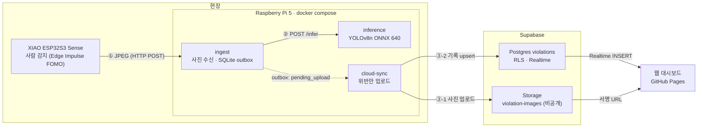

# ppe-edge-guard

**Edge AI + 클라우드 기반 안전모·안전조끼 미착용자 감지 시스템**

현장의 소형 카메라(ESP32)가 사람을 감지하면 사진을 찍고, 라즈베리파이가 안전모·조끼 착용 여부를 판정합니다.
**미착용(위반)으로 판정된 건만** 사진과 기록을 클라우드(Supabase)에 올리고, 관리자는 웹 대시보드에서 실시간으로 확인합니다.

- 대시보드: https://physical-ai-team.github.io/ppe-edge-guard/ (로그인 필요)
- 상태: **실제 장비 전체 동작 확인 완료** (ESP32 → Raspberry Pi 5 → Supabase → 웹, 2026-11-02), 발표 시연 완료

---

## 목차

1. [핵심 특징](#핵심-특징)
2. [시스템 구성](#시스템-구성)
3. [동작 흐름](#동작-흐름)
4. [결과 (실측)](#결과-실측)
5. [팀과 역할](#팀과-역할)
6. [기술 스택](#기술-스택)
7. [폴더 구조](#폴더-구조)
8. [실행 방법](#실행-방법)
9. [테스트](#테스트)
10. [설계 결정](#설계-결정)
11. [한계와 향후 과제](#한계와-향후-과제)
12. [문서 안내](#문서-안내)
13. [진행 이력](#진행-이력)
14. [출처·라이선스](#출처라이선스)

---

## 핵심 특징

| 특징 | 내용 |
|---|---|
| **2단계 엣지 판정** | ESP32가 작은 모델(Edge Impulse FOMO, 64×64)로 "사람이 있나"만 빠르게 보고, 사람이 있을 때만 고해상도로 찍어 보냅니다. 무거운 안전모·조끼 판정은 라즈베리파이(YOLOv8n)가 합니다. |
| **위반만 클라우드로** | 착용자·사람 없는 사진은 Pi에서 바로 삭제합니다. 위반 사진만 업로드해서 개인정보 노출과 전송량을 줄입니다. |
| **네트워크가 끊겨도 유실 없음** | Pi가 SQLite outbox에 먼저 기록하고, 업로드는 따로 재시도합니다(지수 백오프). 인터넷이 돌아오면 밀린 위반이 자동으로 올라갑니다. |
| **중복·재시도에 안전** | ESP32 촬영 ID로 중복 수신을 거르고, Supabase에는 같은 경로·같은 `event_id`로 덮어써서(upsert) 몇 번 재시도해도 결과가 같습니다. |
| **보안** | 사진 버킷은 비공개, 웹은 로그인한 사용자만 읽기(RLS), 사진은 1시간짜리 서명 URL로만 표시합니다. 쓰기 키(service_role)는 Pi에만 있습니다. |
| **현장 운영** | Pi는 전원만 넣으면 컨테이너가 자동으로 뜹니다. 로컬 사진 보관 기간·용량 상한, 판단 불가(unknown) 통계를 Pi에서 관리합니다. |

---

## 시스템 구성



| 구성 요소 | 하드웨어·플랫폼 | 역할 |
|---|---|---|
| 카메라 | Seeed XIAO ESP32S3 Sense (OV3660) | 0.2초마다 저해상도 화면으로 사람 감지 → 감지되면 1280×1024 JPEG 촬영 → Pi로 전송 |
| ingest | Raspberry Pi 5 4GB, Docker | 사진 저장, 이벤트 기록, inference 호출, 결과에 따라 위반/착용 분류, 로컬 사진 정리 |
| inference | 〃 | ONNX Runtime으로 YOLOv8n 실행, 사람별 안전모·조끼 착용 판정 (OpenCV 없이 numpy + Pillow) |
| cloud-sync | 〃 | 위반 이벤트를 Supabase Storage → DB 순서로 업로드, 실패 시 재시도 |
| Supabase | 클라우드 | 위반 사진(비공개 버킷)과 기록(`violations` 테이블), 로그인, 실시간 알림 |
| 웹 대시보드 | GitHub Pages | 로그인, 오늘의 위반 통계, 위반 목록·필터, 사진과 박스 표시, 실시간 갱신 |

서비스 사이의 데이터 형식(①②③)은 [docs/interfaces.md](docs/interfaces.md)에 계약으로 고정되어 있습니다. 덕분에 팀원 다섯 명이 서로의 코드나 장비 없이 동시에 개발했습니다.

---

## 동작 흐름

```
1. ESP32   저해상도(QVGA) 화면으로 0.2초마다 사람 감지 (점수 0.3 이상 2회 연속)
2. ESP32   감지되면 SXGA(1280×1024) 촬영 → Pi로 HTTP POST  (실패 시 1→2→4초 재시도)
           촬영 후 5초 쉼(쿨다운). 사람이 계속 있으면 5~7초마다 1장
3. ingest  사진 저장, 이벤트 기록(received) → 202 응답
4. ingest  inference에 사진 전송 → 사람별 판정 받음
5. ingest  위반이면 pending_upload, 아니면 compliant(사진 즉시 삭제)
6. sync    pending_upload를 Supabase에 업로드 → uploaded
7. 웹      새 위반이 실시간으로 목록·통계에 나타남 (KST로 표시)
```

| Pi 판정 | 클라우드 업로드 | 로컬 사진 |
|---|---|---|
| 안전모 **또는** 조끼 미착용 | ✅ 사진 + 기록 | 7일 보관 후 삭제 |
| 둘 다 착용 | ❌ | 즉시 삭제 |
| 사람 없음 (ESP32 오탐) | ❌ | 즉시 삭제 |
| 판단 불가 (`unknown`, 가려짐·뒷모습 등) | ❌ 위반으로 보지 않음 | 즉시 삭제, **건수만 통계로 기록** |

---

## 결과 (실측)

모든 수치는 2026-11-02 실제 장비에서 측정했습니다.

### 전체 동작 (M2)
실제 ESP32가 사람을 감지해 촬영 → Pi가 640 모델로 판정 → 위반만 Supabase 업로드 → 웹 표시까지 확인했습니다.
- 한 번의 시험에서 ESP32가 45초 동안 6장을 촬영했고, 그중 조끼 미착용 1장만 클라우드에 올라갔습니다. 나머지 5장(착용 3, 사람 없음 2)은 Pi에서 걸렀습니다.
- 촬영부터 Pi 판정까지 약 **1~1.5초**입니다.

### ESP32 (XIAO ESP32S3 Sense)
| 항목 | 값 |
|---|---|
| 사람 감지 추론 | 약 34ms (DSP 2ms + 모델 32ms, ESP-NN) |
| 고해상도 촬영 (해상도 전환 포함) | 0.22~0.35초 |
| Pi로 전송 | 0.4~1.2초 (부팅 직후 첫 전송은 3~4.6초) |
| 사진 크기 | SXGA JPEG 40~100KB |
| 시연 영상 인식 | 5개 중 4개 장면에서 사람 감지 촬영 (모델 v1.0.44) |

### Raspberry Pi 5 (4GB)
| 항목 | 값 |
|---|---|
| **안전모·조끼 판정 (640)** | **장당 약 0.2~0.25초** (전처리 약 75ms + 모델 약 150ms) |
| 메모리 | inference 최대 160MiB, ingest·cloud-sync 각 약 50MiB (4GB 중) |
| 첫 빌드 | ingest + cloud-sync 201초, inference 추가 124초 |
| 부하 시험 | 0.5초 간격 50장 전송 → 50/50 수신, 업로드 누락 0 |
| 재부팅 | 손대지 않아도 모든 컨테이너 자동 시작, 데이터 유지 |

### 판정 정확도 (시나리오 영상 평가, 프레임 단위)
입력 크기를 416에서 640으로 바꾼 근거입니다. 상세: [gateway/models/README.md](gateway/models/README.md)

| 시나리오 | 정답 | 위반 판정 정답률 416 → **640** |
|---|---|---|
| 둘 다 착용 | 위반 아님 | 32/32 → **32/32** |
| 안전모만 착용 | 위반 (조끼 X) | 32/32 → **32/32** |
| 조끼만 착용 | 위반 (안전모 X) | 0/32 → **14/32** |
| 둘 다 미착용 | 위반 | 31/32 → **32/32** |
| **합계** | | **74% → 86%**, 거짓 경보 0 |

조끼 판정은 97%로 안정적이고, 안전모 **미착용**은 640에서도 아직 어렵습니다([한계](#한계와-향후-과제) 참고).

---

## 팀과 역할

| 이름 | 역할 | 맡은 부분 | 주요 결과물 |
|---|---|---|---|
| **김세광** (팀장) | 게이트웨이·인프라·통합 | `gateway/ingest`, `gateway/cloud-sync`, `gateway/common`, docker compose, 라즈베리파이 배포, 인터페이스 계약, 통합 테스트, PR 리뷰·머지 | ingest(수신·outbox·사진 정리·통계 API), cloud-sync(Supabase 업로드·재시도·`upload_failed`), compose 3서비스 구성, Pi 배포 문서·점검 스크립트, M1·M2 통합 검증과 Pi 실측 |
| **박민성** | ESP32 펌웨어 | `firmware/` | 촬영·전송 펌웨어(계약 형식, 재시도, 쿨다운, 재연결, 중복 방지 ID), Edge Impulse 사람 감지 모델 학습·탑재(v1.0.44), 보드 실기 시험 6종 |
| **김정윤** | AI 모델·추론 서비스 | `gateway/inference`, `gateway/models`, `training/` | inference 서비스(ONNX 추론, numpy + Pillow 전처리, 사람별 PPE 판정 규칙), 클래스 매핑(`classes.yaml`), 공개 모델 export·검증 스크립트, 416 vs 640 시나리오 평가 |
| **조아람** | 클라우드·웹·발표 | `supabase/`, `web/` | `violations` 스키마·비공개 버킷·RLS·Auth·Realtime, 관제 대시보드(실시간 갱신, 박스 표시, 필터·통계), GitHub Pages 배포, 발표 자료 |
| **이기태** | 검증·시연 | — | 시나리오 5종(둘 다 착용 / 안전모만 / 조끼만 / 둘 다 미착용 / 2인) 검증·시연 영상 촬영 → 모델 평가와 ESP32 인식 시험, 발표 시연에 사용 |

협업 방식: 서비스 간 데이터 형식을 [docs/interfaces.md](docs/interfaces.md)로 먼저 확정하고, 각자 가짜 입력(mock·dry_run·fake_esp32)으로 독립 개발한 뒤 통합했습니다. 모든 변경은 `feat/<영역>-<주제>` 브랜치 → PR로 들어갔고, 폴더별 담당자는 [CLAUDE.md](CLAUDE.md)와 [.github/CODEOWNERS](.github/CODEOWNERS)에 있습니다.

---

## 기술 스택

| 영역 | 사용 기술 |
|---|---|
| 카메라 | Seeed XIAO ESP32S3 Sense, Arduino(ESP32 core 3.3.x), esp32-camera, Edge Impulse FOMO (int8, 64×64) |
| 게이트웨이 | Raspberry Pi 5 4GB, Raspberry Pi OS Lite 64-bit, Docker Compose, Python 3.11, FastAPI, httpx, SQLite(WAL), micromamba |
| 추론 | YOLOv8n (ONNX, 입력 640), ONNX Runtime CPU, numpy, Pillow |
| 학습·평가 | Ultralytics (export·비교용), Hugging Face 공개 PPE 모델, Roboflow "Construction Site Safety" 클래스 체계 |
| 클라우드 | Supabase (Postgres + RLS, Storage, Auth, Realtime), Supabase CLI |
| 웹 | 정적 HTML + JavaScript(ES module), supabase-js, GitHub Pages + GitHub Actions |
| 테스트 | pytest(게이트웨이 3서비스), g++ 단위 시험(펌웨어 계약 규칙), 보드 실기 시험 |

---

## 폴더 구조

```
ppe-edge-guard/
├── firmware/                 ESP32 펌웨어 (박민성)
│   ├── ppe_cam/              Arduino 스케치: 카메라, 사람 감지, 전송, 재시도
│   ├── tests/                계약 규칙(proto) PC 단위 시험
│   └── build.ps1             컴파일·업로드, Edge Impulse 라이브러리 설치
├── gateway/                  라즈베리파이 docker compose
│   ├── ingest/               사진 수신·SQLite outbox·inference 호출·사진 정리 (김세광)
│   ├── inference/            YOLOv8n ONNX 추론·PPE 판정 (김정윤)
│   ├── cloud-sync/           Supabase 업로드·재시도 (김세광)
│   ├── common/ppe_common/    공용: DB 스키마·상태, 시각·경로 규칙
│   ├── models/               classes.yaml (ONNX 파일은 git 제외)
│   ├── scripts/              fake_esp32.py(가짜 카메라), pi_check.sh(Pi 점검)
│   └── docker-compose.yml
├── supabase/                 테이블·RLS·Storage 마이그레이션, seed (조아람)
├── web/                      관제 대시보드 (조아람)
├── training/                 모델 export·ONNX 검증·시나리오 평가 (김정윤)
├── docs/                     계약, 단독 테스트, Pi 배포 문서
└── CLAUDE.md                 팀 기준 문서 (역할, 규칙, 명령, 설계 결정)
```

---

## 실행 방법

> 비밀값은 템플릿을 복사해서 채웁니다. 모두 gitignore 대상이라 커밋되지 않습니다.
> `gateway/.env.example` → `.env` · `firmware/ppe_cam/secrets.example.h` → `secrets.h` · `web/config.example.js` → `config.js`

### 1) 노트북에서 게이트웨이만 (장비·모델·클라우드 없이, 5분)

Windows PowerShell + Docker Desktop 기준입니다.

```powershell
cd gateway
Copy-Item .env.example .env          # DEVICE_TOKEN=dev-token, INFERENCE_MODE=mock, SYNC_MODE=dry_run
docker compose up -d --build ingest cloud-sync

conda env create -f ingest/environment.yml
conda run -n ppe-ingest python scripts/fake_esp32.py --count 5 --wait   # 가짜 카메라로 5장 전송
curl.exe http://localhost:8000/api/v1/stats                               # 판정·업로드 통계
```

### 2) 실제 모델로 추론까지

```powershell
conda env create -f training/environment.yml
conda run -n ppe-training python training/export_hf_model.py    # → gateway/models/yolov8n-ppehf-640-v1.onnx
# gateway/.env: INFERENCE_MODE=http
cd gateway; docker compose up -d --build                           # ingest + inference + cloud-sync
conda run -n ppe-ingest python scripts/fake_esp32.py --images <사진 폴더> --wait
```

### 3) Supabase로 실제 업로드
`gateway/.env`에 `SYNC_MODE=supabase`, `SUPABASE_URL`, `SUPABASE_SERVICE_ROLE_KEY`(secret 키)를 넣고 `docker compose up -d`. 테이블·버킷은 [supabase/README.md](supabase/README.md)대로 만듭니다.

### 4) 라즈베리파이 배포
[docs/deploy_raspberry_pi.md](docs/deploy_raspberry_pi.md) — OS 설치, SSH 키, Docker, **memory cgroup 설정(필수)**, 빌드, 측정, Wi-Fi 변경, 문제 해결까지 실제로 따라 한 순서입니다.

### 5) ESP32 펌웨어
[firmware/README.md](firmware/README.md) — `secrets.h`에 Wi-Fi·Pi IP·토큰을 넣고, Edge Impulse 라이브러리 zip을 설치한 뒤:
```powershell
powershell -File firmware/build.ps1 -InstallLib <ei-ppe-person-fomo-arduino-1.0.44.zip>   # 처음 한 번
powershell -File firmware/build.ps1 -Port <PORT>                                           # 컴파일 + 업로드
```

### 6) 웹 대시보드
`main`에 머지되면 GitHub Actions가 Pages로 자동 배포합니다. 로컬 실행은 [web/README.md](web/README.md).

### 운영할 때
Pi 전원 → 1~2분 뒤 컨테이너 자동 시작 → ESP32 전원(USB 충전기·보조배터리) → 웹 로그인. **Pi와 ESP32는 같은 Wi-Fi**에 있어야 하고, ESP32의 Pi 주소가 맞아야 합니다.

---

## 테스트

```powershell
cd gateway/ingest;     conda run -n ppe-ingest     python -m pytest -q   # 40개
cd gateway/cloud-sync; conda run -n ppe-cloud-sync python -m pytest -q   # 27개
cd gateway/inference;  conda run -n ppe-inference  python -m pytest -q   # 27개 (ONNX가 있으면 실제 모델 시험 포함 28개)
powershell -File firmware/tests/run_tests.ps1                            # 펌웨어 계약 규칙 (g++)
```

| 대상 | 무엇을 검사하나 |
|---|---|
| ingest | 계약 헤더·응답 코드, 중복 제거, 시계 오류 처리, 상태 전이, 사진 정리 정책, 통계 |
| cloud-sync | 업로드 순서·형식(계약 ③), 일시/영구 오류 분류, 백오프, `upload_failed`, 수동 재시도 |
| inference | 응답 형식(계약 ②), 사람별 판정 규칙, 시나리오 5종, 전처리·NMS, 오류 코드 |
| 펌웨어 | 헤더 값, 응답 분류(재시도 여부), 재시도 간격, 시각 형식 |
| 실기 | 보드 6종(정상·중복·토큰 오류·서버 중단·재전송·타이머), M1·M2 전체 흐름 |

단독 테스트용 가짜 입력(mock 추론, dry_run 업로드, 가짜 카메라)은 [docs/dev-testing.md](docs/dev-testing.md)에 정리되어 있습니다.

---

## 설계 결정

| 결정 | 이유 |
|---|---|
| 컨테이너 간 **HTTP + SQLite outbox** | 메시지 큐 없이도 재시작·네트워크 단절에 안전. 각 서비스를 따로 띄워 시험 가능 |
| inference에 **사진 바이트를 직접 전송** | 공유 볼륨 경로에 의존하지 않아 inference를 노트북에서 단독 실행·curl 시험 가능 |
| **UTC로 저장, KST는 화면에서만** | 시간대 혼동 방지. 촬영·수신·판정 시각을 따로 기록하고, 카메라 시계가 틀리면 `clock_synced=false` |
| **`unknown`은 위반이 아님** | 가려짐·뒷모습을 위반으로 올리면 거짓 경보가 늘어남. 대신 비율을 통계로 남겨 카메라·모델 점검에 사용 |
| **입력 640** (416에서 변경) | 416은 안전모 미착용을 거의 못 잡음. Pi 5에서 640도 장당 약 0.25초로 충분 |
| OpenCV 없이 numpy + Pillow | 이미지·의존성을 가볍게. 리사이즈는 OpenCV와 같은 결과가 나오도록 직접 구현 |
| 모델·비밀값·얼굴 사진은 git 제외 | 용량·보안·개인정보. 모델은 고정 리비전 + 해시 검사로 누구나 같은 파일 생성 |

전체 목록은 [CLAUDE.md "확정된 설계 결정"](CLAUDE.md#확정된-설계-결정)에 있습니다.

---

## 한계와 향후 과제

| 항목 | 현재 | 개선 방향 |
|---|---|---|
| 안전모 **미착용** 검출 | 640에서도 `조끼만 착용` 장면의 절반 이상을 놓치고, 미착용을 착용으로 잘못 보는 경우가 약 15% | 직접 학습 모델(T1: Roboflow 데이터 + 현장 영상 프레임)로 교체. `.env`의 `MODEL_PATH`만 바꾸면 됨 |
| 판단 불가 비율 | 실제 시험에서 안전모 unknown 최대 57% (사람이 작게 찍힐 때) | 카메라 거리·각도 조정(1~2m, 정면), 학습 모델 |
| 같은 사람 중복 기록 | 사람이 계속 서 있으면 5~7초마다 위반이 쌓임 | 쿨다운 늘리기, 또는 서버에서 같은 장치·짧은 시간 위반 묶기 |
| ESP32 사람 감지 | 점수가 기준(0.3) 근처라 장면에 따라 흔들림 | 현장 영상으로 재학습, 기준 조정. 대안으로 타이머 촬영(Pi가 판정) |
| Pi 전원 | 추론 부하 중 전압 부족 기록 (`0x50000`) | 27W 공식 어댑터 사용 |
| 네트워크 | ESP32 펌웨어에 Wi-Fi·Pi IP가 고정 | 공유기 DHCP 예약, 설정 모드(Wi-Fi 프로비저닝) 추가 |

---

## 문서 안내

| 문서 | 내용 |
|---|---|
| [CLAUDE.md](CLAUDE.md) | 팀 기준 문서: 역할, 진행 계획·상태, 브랜치·보안 규칙, 명령, 설계 결정 |
| [docs/interfaces.md](docs/interfaces.md) | 서비스 간 데이터 계약 v1.2 (ESP32→ingest, ingest→inference, cloud-sync→Supabase) |
| [docs/dev-testing.md](docs/dev-testing.md) | 담당자별 단독 테스트 방법과 가짜 입력 |
| [docs/deploy_raspberry_pi.md](docs/deploy_raspberry_pi.md) | Pi 배포 절차, 실측 기록, 문제 해결 |
| [firmware/README.md](firmware/README.md) | 펌웨어 빌드·설정·실기 시험 결과 |
| [gateway/ingest/README.md](gateway/ingest/README.md) · [cloud-sync](gateway/cloud-sync/README.md) · [inference](gateway/inference/README.md) | 서비스별 API·동작·실행 |
| [gateway/models/README.md](gateway/models/README.md) | 모델 출처·export·416 vs 640 평가 |
| [supabase/README.md](supabase/README.md) · [web/README.md](web/README.md) | 스키마·RLS 적용, 대시보드 기능·배포 |

---

## 진행 이력

| 단계 | 내용 | PR |
|---|---|---|
| 기반 | 레포 구조, 팀 역할, 인터페이스 계약 v1.0 | #1, #2 |
| 게이트웨이 | ingest + mock 추론 + 가짜 카메라 (계약 v1.1) | #3 |
| 클라우드 업로드 | cloud-sync, 재시도, `upload_failed` (계약 v1.2) | #5 |
| 모델 | 공개 PPE 모델 export·검증, 640 전환, 시나리오 평가 | #4, #11, #15 |
| Supabase·웹 | 스키마·RLS·버킷, 대시보드, Pages 배포 | #7, #8, #13 |
| 펌웨어 | 촬영·전송(F1), Edge Impulse 사람 감지(F2) | #9, #14 |
| 추론 서비스 | inference 컨테이너 | #10 |
| 라즈베리파이 | 배포 문서, 실측, Wi-Fi·cgroup 설정 | #6, #12, #17 |
| 통합 | compose에 inference 연결, M1·M2 전체 동작 확인 | `feat/gateway-compose-inference` |

| 마일스톤 | 상태 |
|---|---|
| M1 노트북 전체 동작 | ✅ |
| M2 실제 ESP32 → Pi → Supabase → 웹 | ✅ |
| M3 학습 모델 + Edge Impulse 펌웨어 | ◐ 펌웨어 완료, 모델은 공개 모델로 대체 |
| M4 시나리오 검증·시연 | ✅ 발표 시연 완료 |

---

## 출처·라이선스

- 안전모·조끼 모델: [Hansung-Cho/yolov8-ppe-detection](https://huggingface.co/Hansung-Cho/yolov8-ppe-detection) (MIT, 리비전 `ac0027bd38bc` 고정). 클래스 체계는 Roboflow "Construction Site Safety"를 따르며, 데이터셋 라이선스는 원 제공처를 따릅니다.
- 사람 감지 모델: Edge Impulse 프로젝트 `ppe-person-fomo` (팀 학습, v1.0.44).
- YOLOv8: [Ultralytics](https://github.com/ultralytics/ultralytics) (export·결과 비교에 사용, 게이트웨이 런타임에는 포함하지 않음).
- 테스트·시연 영상과 사람 얼굴이 나오는 사진은 저장소에 포함하지 않습니다.
